# 01 总览与目录地图

[← 索引](../engineering-architecture.md) · [下一篇：走一遍 →](02-walkthrough.md)

## 1. 要解决的问题

Go 的 goroutine 栈很小（起步几 KB），不够时运行时会**整块搬到一块更大的内存**（copystack），
然后把栈上「指向栈自己的指针」逐个加上搬动距离。Go 编译器生成的每个函数都配合这件事：

1. **入口栈检查**：比较 `SP` 和 `g.stackguard0`，不够就调用 `runtime.morestack_noctxt`。
2. **pc 表**：每个 pc 上 SP 偏了多少（`SP_DELTA`，Go 里叫 pcsp）、此处能不能被抢占（`UNSAFE_POINT`）、源文件行号。
3. **栈图（stackmap / pointer map）**：每个调用点，帧里哪些 8 字节字是指针。搬栈和 GC 靠它。

普通 C 编译器什么都不给，所以 cgo 要切到系统栈。goc 的思路是：**让 LLVM 生成的 C 代码也带上这三样东西**，
再打包成 Go 链接器认得的目标文件。为此 C 里的指针要分「颜色」，编译器才知道哪些值是栈地址。

## 2. 术语表（LLVM 后端新手向）

| 术语 | 意思 |
|---|---|
| IR / `.ll` | LLVM 的中间表示，文本形式是 `.ll`。`opt` 读写它 |
| pass | 对 IR（或机器指令）做一次分析或改写的一段代码。**IR pass** 在 `opt` 里跑，**机器 pass**（MachineFunction pass）在 `llc` 里跑 |
| new-PM 插件 | `opt -load-pass-plugin=libGocPasses.so -passes=名字` 这种加载方式。goc 的所有 IR pass 都在 `libGocPasses.so` |
| `llc` / `goc-llc` | 把 IR 编成汇编。`goc-llc` 是 goc 自己的 llc：同样的流程，末尾多插几个机器 pass |
| ISel / PEI / RA | 指令选择 / 序言尾声插入（决定帧布局）/ 寄存器分配。「post-RA」「after PEI」指这些步骤之后 |
| 被调用者保存寄存器（CSR） | 函数调用后保持不变的寄存器（x86-64 的 RBX、R12–R15，arm64 的 X19–X28）。LLVM 喜欢把跨调用的值放这里 |
| alloca | IR 里「在栈帧上开一块」。一个 alloca 最终是帧里的一个槽（slot） |
| `llvm.experimental.stackmap` | LLVM 内建：在某处记录若干值的位置。goc 用它记「这次调用时哪些帧槽是指针」 |
| metadata（`!goc.color` 等） | 挂在 IR 指令上的附加信息，不影响语义。goc 用它在 pass 之间传颜色和槽身份 |
| sptr / cptr / uptr / gptr / auto_ptr | 指针颜色：栈指针 / C 堆或全局指针 / 编码后的可搬栈指针 / Go 堆指针 / 待推断。见 `docs/syntax-guide.md` |
| ABI0 / ABIInternal | Go 的两种调用约定：ABI0 全走栈（汇编函数用），ABIInternal 走寄存器（Go 编译器默认） |
| thunk | 胶水函数。goc 给每个 C 函数生成一个 Go ABIInternal 入口 `F`，它把参数搬到 SysV/AAPCS 寄存器，再调用 C 本体 `F.impl` |
| `.gocobj` | goc 的中间产物：一个普通 ELF 目标文件 + 若干 `.goc.*` 表 |
| goobj | Go 工具链自己的目标文件格式（`go tool compile` 产出的 `.o`） |

## 3. 全流程图

```mermaid
flowchart TD
  A["foo.c（带 cptr/sptr/... 注解）"] -->|"打补丁的 clang 19.1.7<br/>clang/patches + clang/sema/SemaGocColors.cpp<br/>-emit-llvm -O3 -Xclang -disable-llvm-passes"| B["a.ll<br/>颜色以 annotate 形式进 IR"]
  B -->|"opt -passes=goc-color-escape<br/>（GOC_COLOR_REPORT=1 时先 print goc-color）"| C["a.color.ll<br/>!goc.color、uptr 编解码调用"]
  C -->|"opt -passes=goc-inline-gate"| D["a.gate.ll"]
  D -->|"opt default O3 管线（去掉 argpromotion、globalopt）<br/>+ function(goc-name-blocks)"| E["a.opt.ll"]
  E -->|"opt -passes=goc-stackmap"| F["a.sm.ll<br/>根槽 + llvm.experimental.stackmap"]
  F -->|"opt -passes=goc-reanchor"| G["a.reanchor.ll<br/>指针实参锚定、goc.oldfp"]
  G --> RB{{"tools/goc/realbody.sh"}}
  RB -->|"goc-lower fix-ir / rename-ir"| H["body.ll"]
  H -->|"goc-lower goabi"| I["body.impl.ll（F → F.impl）<br/>thunks.s + thunks.goc.s + goabi.json"]
  I -->|"goc-llc -function-sections -goc-tables<br/>机器 pass：StackmapPlacement, X86FrameAddrFix / A64*, StackCheck, ObjTables"| J["body.s + body.goc.s"]
  J -->|"goc-lower align-asm（仅 amd64）<br/>cat body.s thunks.s body.goc.s thunks.goc.s"| K["body.thunks.s"]
  K -->|"llvm-mc -filetype=obj"| L["foo.gocobj（ELF + .goc.*）"]
  L -->|"gocobj2goobj -p pkg -symabis<br/>按 Go 版本构建"| M["foo.goobj + foo.symabis"]
  M -->|"go build -a -toolexec tools/goc/toolexec_recognize_goobj.sh<br/>asm 阶段追加 symabis；compile 阶段 pack 进 _pkg_.a"| N["Go 链接器 → 可执行文件"]
```

文件名就是 `GOC_KEEP_TMP=1` 时临时目录里看到的名字（`cmd/goc` 一个目录，`realbody.sh` 一个目录）。
`-O0` 时 C→G 之间的 inline-gate / O3 / stackmap / reanchor 不在 `cmd/goc` 里跑，`realbody.sh` 只补跑 `goc-stackmap`（见 02 篇）。

## 4. 命令行入口 `cmd/goc`

`cmd/goc` 是一个 bash 脚本（464 行），开头 `source scripts/goc-flags.sh` 和 `scripts/goc-product-lib.sh`。子命令：

| 子命令 | 实现 | 说明 |
|---|---|---|
| `goc build foo.c -o foo.goobj` | `cmd_build`（`cmd/goc` 内） | 单个 C 文件 → goobj。**默认 `-O0`**，读继承的 `GOC_*`，flag 优先 |
| `goc go [dir] [-o bin]` | `scripts/goc-go.sh` | 编一个 Go 包里所有 `*.c` 再 `go build`。**忽略继承的 `GOC_*`**（`goc_isolate_product_env`），默认 `-O3 --default-ptr-color cptr --fast-stack-alloca`（`goc_product_defaults`）。只支持 linux/amd64 |
| `goc check` | `scripts/goc-check.sh` | 复制 `examples/hello` 到临时目录跑 `goc go`，要求输出 `hello 42` |
| `goc cc …` | `cmd_cc` | 用打补丁的 clang 加 `-DGOC_USE_INTREE_ATTRS -I include` 直接调用 |
| `goc test [--plugin]` | `cmd_test` | `test/clang/run.sh` + `test/e2e/realbody/run.sh` |
| `goc toolchain status\|pack DEST` | `scripts/goc-toolchain.sh` | 看工具 / 打发布包 |
| `goc version` | 读 `VERSION` | |

flag 解析统一在 `scripts/goc-flags.sh` 的 `goc_consume_flag`：每个 flag 落成一个 `GOC_*` 环境变量，再传给下游脚本和 pass。
完整列表见 `goc build --help`（`goc_flags_help`）。常用的对应关系：

| flag | 环境变量 | 谁读 |
|---|---|---|
| `-O0..-O3` | `GOC_OPT_LEVEL` | `cmd/goc`、`realbody.sh` |
| `--default-ptr-color C` | `GOC_DEFAULT_PTR_COLOR` | `cmd/goc` → `goc-color-escape -default-ptr-color=` |
| `--fast-stack-alloca` | `GOC_INLINE_DYNALLOC=1` | `SMUptrInline.cpp`（`getenv`） |
| `--color-report` | `GOC_COLOR_REPORT=1` | `cmd/goc`：加 `-g` 并先跑 `print<goc-color>` |
| `--arch amd64\|arm64` | `GOC_ARCH` | `cmd/goc`、`realbody.sh`、`SMUptrInline.cpp` |
| `--fixed-g` | `GOC_FIXED_G=1` | `realbody.sh` → `goc-llc -reserve-goc-r14 -goc-fixed-g`（amd64） |
| `--csr-adjust` | `GOC_CSR_ADJUST=1` | `SMReanchor.cpp`（x86-only） |
| `--keep-tmp[=DIR]` | `GOC_KEEP_TMP` | `cmd/goc`、`realbody.sh` |
| `--opt-extra` / `--llc-extra` / `--llc-opt` | `GOC_OPT_EXTRA` / `GOC_LLC_EXTRA` / `GOC_LLC_OPT` | 实验用 |
| `--pkg PATH` | `GOC_PKG` | `realbody.sh` → `gocobj2goobj -p` |
| `--ir-renames SPEC` | `GOC_IR_RENAMES` | `goc-lower rename-ir` |
| `--libcall-impl SPEC` | `GOC_LIBCALL_IMPL` | `tools/gocobj2goobj/convert.go`（`os.Getenv`） |
| `--stackmap PATH` | `GOC_STACKMAP` | 指定 `libGocPasses.so` |

只供调试、没有 flag 的环境变量：`GOC_FRAMEADDR_FIX`、`GOC_FRAMEADDR_TRACE`、`GOC_FRAMEADDR_STATS`、`GOC_FRAMEADDR_DEBUG`、`GOC_FRAMEADDR_TAINT`（`lib/Target/X86`），
`GOC_STACKMAP_PLACEMENT_TRACE`（`GocStackmapPlacement.cpp`），`GOC_PROFILE`（覆盖 realbody 传给 goc-llc 的 profile）、`GOC_CACHE`（按 Go 版本构建的转换器缓存目录）。
`GOC_FRAMEADDR_MODE` 已移除，设成 `gep` 以外的值 `realbody.sh` 直接报错。

工具定位：clang 只认 `bin/clang`（发布包）或 `third_party/llvm-19.1.7-clang-build/bin/clang`（源码树），没有 `--clang`；
`goc-llc` / `libGocPasses.so` 先找 `passes/`（发布包）再找 `build/llvm/`（源码树）。

## 5. 目录地图

| 路径 | 职责 | 关键文件 |
|---|---|---|
| `cmd/goc` | CLI 入口（bash） | `cmd/goc` |
| `scripts/` | 驱动库与构建 / 发布 / CI 脚本 | `goc-flags.sh`（flag ↔ `GOC_*`）、`goc-product-lib.sh`（找 clang/opt/goc-lower）、`goc-go.sh`、`goc-check.sh`、`build-clang.sh`、`apply-patches.sh`、`build-passes.sh`、`pack-release.sh`、`ci-test.sh`、`check-file-size.sh`（单文件 800 行） |
| `clang/` | 前端：Clang 补丁、树内 Sema、树外插件 | `patches/0001-Attr.td-goc-colors.patch`、`0003-mirror-goc-colors-before-codegen.patch`、`0004-wire-sema-goc-colors.patch`、`sema/SemaGocColors.cpp`、`plugin/GocClangPlugin.cpp` |
| `include/` | 用户头文件 | `goc.h`（颜色宏 `cptr(T)` 等）、`goc_uptr.h` |
| `llvm/include/Goc/` | goc LLVM 代码的公共头 | `ColorEscape.h`、`StackMap.h`、`MachinePasses.h`、`StackCheck.h`、`AArch64Frame.h`、`SlotMD.h`、`AbiProfiles.def` |
| `llvm/include/Goc/Internal/` | 同一 pass 家族内部共享状态 | `ColorEscape.h`、`StackMap.h` |
| `llvm/lib/Analysis/GocColor/` | 颜色播种与传播（只读）、`print<goc-color>` 报表 | `ColorAnalysis.cpp`、`ColorPrinter.cpp` |
| `llvm/lib/Analysis/StackMap/` | safepoint、栈地址、跨调用使用的只读查询 | `SafepointAnalysis.cpp` |
| `llvm/lib/Transforms/ColorEscape/` | IR pass `goc-color-escape` | `GocColorEscape.cpp`、`CECheck.cpp`、`CERewrite.cpp` |
| `llvm/lib/Transforms/StackMap/` | IR pass `goc-stackmap`、`goc-reanchor`、`goc-inline-gate`、`goc-name-blocks`、`goc-pin-i64` | `GocStackMap.cpp`（注册）、`SMStackMap.cpp`、`SMReanchor.cpp`、`SMRoots.cpp`、`SMUptrInline.cpp`、`SMPinI64.cpp` |
| `llvm/lib/Plugin/` | `libGocPasses.so` 的注册入口 | `GocPasses.cpp` |
| `llvm/lib/CodeGen/` | 与架构无关的机器 pass | `GocStackCheck.cpp`、`GocStackmapPlacement.cpp` |
| `llvm/lib/Target/X86/` | x86 栈检查钩子、帧地址修复 | `GocX86StackCheck.cpp`、`GocX86FrameAddrFix.cpp`、`GocX86FrameAddrLattice.cpp` |
| `llvm/lib/Target/AArch64/` | arm64 栈检查钩子、LR 槽、调用后修复 | `GocAArch64StackCheck.cpp`、`GocAArch64Frame.cpp` |
| `llvm/lib/Object/` | `.goc.*` 表的收集与输出 | `GocObjTables.cpp`、`GocObjTablesWriter.cpp`、`GocObjTablesImpl.h` |
| `llvm/tools/goc-llc/` | `goc-llc` 驱动（只是驱动） | `goc_llc.cpp` |
| `llvm/CMakeLists.txt` | 上面全部的构建；产物在 `build/llvm/` | |
| `tools/goc/` | 单文件流水线与 toolexec 钩子 | `realbody.sh`、`toolexec_recognize_goobj.sh` |
| `tools/goc-lower/` + `goobj/lower/` | Go ABI thunk、IR 小修、汇编对齐修正 | `main.go`（子命令 `goabi` `fix-ir` `rename-ir` `align-asm` `fnname` `magic-obj` `has-define`）、`goabi_*.go`、`rewrite.go` |
| `tools/gocobj2goobj/` | `.gocobj` → goobj 转换 | `main.go`、`convert.go`、`data.go`、`pctab.go`、`write.go`、`arm64.go`、`relocmap.go`、`header.go`（另见 `tools/goc/converter.sh`） |
| `tools/goc-objdump/` | 查看 / 校验 `.gocobj` | `main.go`（`dump`、`verify`） |
| `tools/gocobj-diff/` | 两个 goobj 语义比对（开发工具） | `main.go` |
| `gocobj/` | `.gocobj` 的 Go 读写与校验库 | `format.go`、`read.go`、`write.go`、`verify.go`、`abi.go` |
| `gometa/` | 各 Go 版本的事实（内嵌 JSON） | `meta.go`、`data/go1.23.json`…`go1.27.json` |
| `goobjw/` | 自己的 goobj writer / reader | `link.go`、`write.go`、`dwarf.go`、`read.go` |
| `tools/golangc-metadata-resolver/` | 从 GOROOT 生成事实 JSON | `main.go`、`consts.go`、`reviewed.go`（审查过的 Go 函数指纹） |
| `runtime/` | uptr 运行时 | `uptr/goc_uptr_runtime.c`、`uptr/goc_uptr_tls_amd64.S`、`UPTR-MSB.md`、`TLS-HI.md` |
| `test/` | 全部测试（见 07 篇） | `README.md` |
| `examples/` | `hello/`（最小程序）、`hello_colors.c`、`sptr_escape_bad.c` | |
| `bench/` | 基准与 perf-gap 脚本，不在 CI | |
| `docs/` | 用户与设计文档 | `gocobj-format.md`、`go-abi-profiles.md`、`syntax-guide.md` … |
| `third_party/` | 只有说明文件进 git；本地放 LLVM 构建与 QuickJS 源码 | |

工作区里的 `backend/`、`frontend/`、`tests/`、`bin/` 在 git 里没有文件（`git ls-files` 为空），是本地构建残留或发布包布局，不是源码目录。

Go 模块：仓库根是 `github.com/LoyieKing/goc`（含 `gocobj/`、`goobj/…`、`tools/…`）；`test/e2e/*`、`examples/hello` 等各自是独立模块。
